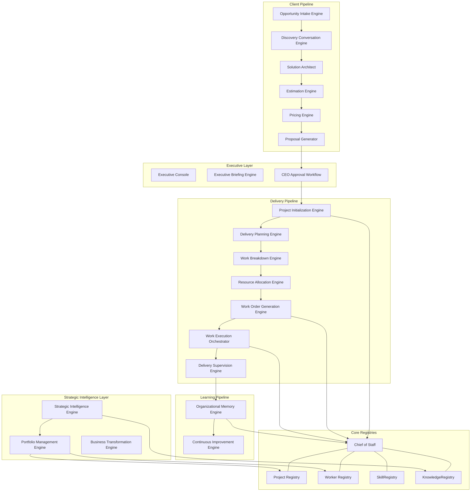

# JBK-OS V1 System Architecture

This document details the software layering, components, and data flows that govern JBK-OS as a unified Executive Operating System.

## Architectural Layers

---

## Component Taxonomy

### 1. Executive Layer
- **Executive Console**: The natural language user interface where the CEO interacts with the system, launches commands, and views briefings.
- **Executive Briefing Engine**: Aggregates worker availability, project counts, risks, and pending deliverables into a structured operational overview.
- **CEO Approval Workflow**: Manages the review and authorization pipeline for client proposals.

### 2. Strategic Intelligence & Portfolio Layer
- **Strategic Intelligence Engine**: Acts as the company "radar", analyzing portfolio metrics, technology shifts, competitor threats, and external signals.
- **Portfolio Management Engine**: Evaluates the entire client engagement portfolio to provide health, utilization, and strategic capacity forecasts.
- **Business Transformation Engine**: Converts blueprints and proposals into advisory outcome roadmaps.

### 3. Client Pipeline
- **Opportunity Intake Engine**: Processes unstructured requests into categorized `OpportunityBrief` objects.
- **Discovery Conversation Engine**: Analyzes briefs to compile list of unknowns and prioritizing questions.
- **Solution Architect**: Designs technical scopes and defines required skills/capabilities.
- **Estimation Engine**: Computes timeline durations, effort hours, and milestone targets.
- **Pricing Engine**: Runs cost analysis and margins, returning payment schedule splits.
- **Proposal Generator**: Compiles proposals with strict confidentiality controls.

### 4. Delivery Pipeline
- **Project Initialization Engine**: Promotes approved proposals to `ACTIVE` projects.
- **Delivery Planning Engine**: Structures projects into timeline phases and workstreams.
- **Work Breakdown Engine**: Deconstructs streams into task hierarchies.
- **Resource Allocation Engine**: Maps workers to tasks based on capability checks.
- **Work Order Generation Engine**: Generates atomic, rollback-supported executable work orders.
- **Work Execution Orchestrator**: Dispatches orders, matches skills to engines, and registers deliverables.
- **Delivery Supervision Engine**: Supervises active delivery, monitoring blockers and worker utilization.

### 5. Learning Pipeline
- **Organizational Memory Engine**: Collects deliverables, blueprints, and outcomes upon project closure and archives them as knowledge.
- **Continuous Improvement Engine**: Processes knowledge logs to discover improvement opportunities for JBK OS itself.

---

## System Boundaries & State Characteristics

- **Stateless Engines**: 18 out of 19 engines are completely stateless. They accept immutable data parameters, execute computations, and return new objects. This prevents race conditions and makes testing highly isolated.
- **Transactional Atomicity**: State mutation is restricted to the **Chief of Staff** and the **Core Registries**. Work Order generation, project status updates, and worker assignments utilize atomic commits; if any single part of the sequence fails, the entire transaction rolls back.
